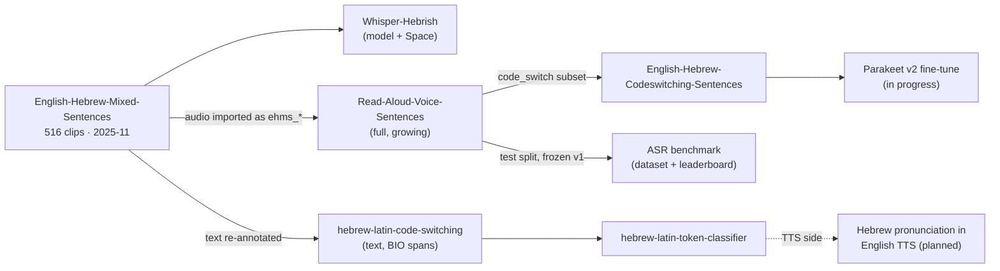

# English-Hebrew Code-Switching Index

Models, datasets, Spaces and companion repositories for **English speech and text that contains Hebrew words** — the way English-speaking immigrants in Israel and Jews in the diaspora actually talk.

**Snapshot:** 2026-10-15 · Machine-readable copy: [`data/index.json`](data/index.json)

---

## The problem

English speakers in Israel drop Hebrew into English all the time: *"I need to pick up my **teudat zehut** from **Misrad Hapnim**"*, *"grab some **bamba** from the **makolet**"*, *"I have to go to **Bituach Leumi** tomorrow"*. Jewish speakers everywhere do the same with religious and community vocabulary.

Some of these words (*Shabbat*, *Torah*, *kosher*) are common enough that English ASR training data has seen them. Most are not. The model falls back to whichever English words sound closest:

| Said | Stock Whisper Large V3 Turbo heard |
| --- | --- |
| *I went to the makolet today… and I also got my teudat zehut.* | *I went to the **Macaulay** today… and I also got my **Theodette Sahoot**.* |

The work indexed here fixes that from two directions:

- **Speech → text (ASR).** Fine-tune speech recognition so it writes the Hebrew word in one consistent romanized spelling. This is the main thread.
- **Text → speech (TTS).** Detect Hebrew words written in Latin letters so a TTS voice pronounces them as Hebrew rather than as English letter strings. This is a sibling thread and shares the vocabulary and the data.

---

## Contents

- [Start here](#start-here)
- [ASR models](#asr-models)
- [Benchmark](#benchmark)
- [Speech datasets](#speech-datasets)
- [Text corpus and classifier](#text-corpus-and-classifier)
- [Spaces and browsers](#spaces-and-browsers)
- [Companion repositories](#companion-repositories)
- [Adjacent: evaluations and personal fine-tunes](#adjacent-evaluations-and-personal-fine-tunes)
- [Hugging Face collections](#hugging-face-collections)
- [How the pieces connect](#how-the-pieces-connect)
- [Related indexes](#related-indexes)

---

## Start here

| If you want to… | Go to |
| --- | --- |
| Hear the problem and the fix side by side | [Whisper-Hebrish Space](https://huggingface.co/spaces/danielrosehill/Whisper-Hebrish) |
| Train an ASR model on code-switched speech | [English-Hebrew-Codeswitching-Sentences](https://huggingface.co/datasets/danielrosehill/English-Hebrew-Codeswitching-Sentences) |
| Compare ASR models on code-switching | [Code-switching ASR leaderboard](https://huggingface.co/spaces/danielrosehill/English-Hebrew-Codeswitching-ASR-Leaderboard) |
| Find Hebrew words in English text | [hebrew-latin-token-classifier](https://huggingface.co/danielrosehill/hebrew-latin-token-classifier) |
| See where the current fine-tune stands | [Parakeet code-switching fine-tune tracker](https://github.com/danielrosehill/English-Hebrew-Codeswitching-Parakeet-Finetune) |

---

## ASR models

### Whisper-Hebrish

Whisper Large V3 Turbo fine-tuned on English sentences containing Hebrew words, so that *makolet* comes out as *makolet* instead of *Macaulay*. Trained on English-Hebrew-Mixed-Sentences in November 2025. This was the first model in the project.

### Parakeet code-switching fine-tune (in progress)

A fine-tune of [`nvidia/parakeet-tdt-0.6b-v2`](https://huggingface.co/nvidia/parakeet-tdt-0.6b-v2) for on-device Android dictation. Parakeet v2's tokenizer has no Hebrew characters, so the model learns one romanized spelling for each Hebrew word. **Status 2026-10-15: collecting data. No model has been trained yet.** The tracker repo below records progress and will link the model once it is released.

---

## Benchmark

### English-Hebrew-Codeswitching-ASR-Benchmark

A replicable benchmark for ASR on English speech that contains Hebrew words, released 2026-10-15. The frozen v1 test set is 145 clips from the Read-Aloud-Voice-Sentences test split, tagged by subset. The headline `clean` subset is 84 clips (11.8 min, 172 Hebrew term occurrences) that overlap no published training set; 33 clips that overlap Whisper-Hebrish's training data are excluded from it. The headline metric is **Hebrew term recall**: the share of Hebrew terms written in their canonical romanized spelling, matched as whole words. The GitHub repo holds the runner and scorer (`ehcs-bench`), a Modal GPU runner and the results JSONs.

v1 results on `clean`:

| Model | Hebrew term recall |
| --- | --- |
| Parakeet code-switching fine-tune v2 | **65.7%** (WER 4.2%) |
| Parakeet code-switching fine-tune v1 | 62.2% |
| Whisper-Hebrish (see caveat) | 54.1% |
| Whisper Large V3 | 45.9% |
| Whisper Large V3 Turbo | 40.1% |
| Parakeet TDT 0.6B v2 (stock) | 32.6% |
| Parakeet TDT 0.6B v3 (stock) | 31.4% |

> *Contamination caveat:* 33 test-set clips overlap Whisper-Hebrish's training data: 26 are the identical recordings it trained on and 7 are new recordings of sentences it trained on. They are excluded from `clean`, the headline subset. Method: [`docs/about.md`](https://github.com/danielrosehill/English-Hebrew-Codeswitching-ASR-Benchmark/blob/main/docs/about.md) in the benchmark repo.

---

## Speech datasets

All recordings come from one speaker, the author: Irish-born, English-speaking, living in Jerusalem. These are single-speaker datasets. They are not a broad corpus.

### Read-Aloud-Voice-Sentences

The full dataset. It contains read-aloud sentences recorded on a phone (OnePlus Nord 3 5G, internal mic), in several categories: `code_switch`, `names` (Jewish and Israeli names and places), `email`/`message`, `tech`, `homophone`, `general`. It grows as new recordings are pushed from the capture app. The train and test splits are term-disjoint.

### English-Hebrew-Codeswitching-Sentences

The code-switching subset of Read-Aloud-Voice-Sentences, meaning every phone recording tagged `code_switch`. Rows are copied unchanged, with the same ids and split. Each Hebrew word has one canonical spelling, and Hebrew proper nouns are capitalised (*Yerushalayim*, *Bituach Leumi*). **Use this one for code-switching ASR training.**

### English-Hebrew-Mixed-Sentences ("Hebrish")

The original dataset of 516 audio-text pairs, recorded on 2025-11-17, and the training set for Whisper-Hebrish. Its audio has since been imported into Read-Aloud-Voice-Sentences as the `ehms_*` rows, with the transcripts brought into line with the canonical spellings.

> *Known defect:* the `hebrew_word` label was filled in by substring search. 114 of 474 labels match only inside an unrelated English word (for example `hi` ← *think*, `chool` ← *school*). Don't use that column as token labels. The re-annotated text lives in hebrew-latin-code-switching.

---

## Text corpus and classifier

### hebrew-latin-code-switching

4,737 English sentences with token-level BIO spans that mark Hebrew words written in Latin letters. 458 of them are dictated sentences. The splits are term-disjoint: train has 987 seed terms, validation 124, test 124. A word is labelled Hebrew only if an English voice would mispronounce it, so *kosher* and *Shabbat* are negatives and *makolet* and *arnona* are positives.

### hebrew-latin-token-classifier

An XLM-RoBERTa-base token classifier that finds Hebrew words in English text. On the term-disjoint test set it scores span F1 **0.941** (P 0.928 / R 0.953), with 0 false positives on 58 hard-negative sentences.

---

## Spaces and browsers

| Space | What it does |
| --- | --- |
| [Whisper-Hebrish](https://huggingface.co/spaces/danielrosehill/Whisper-Hebrish) | Record or upload audio and compare Whisper-Hebrish with stock Whisper Large V3 Turbo side by side |
| [English-Hebrew Code-Switching Browser](https://huggingface.co/spaces/danielrosehill/English-Hebrew-Codeswitching-Browser) | Browse and listen to the code-switching recordings by Hebrew term. Reads straight from the Hub, so new recordings appear as soon as they are pushed |
| [Code-Switching ASR Leaderboard](https://huggingface.co/spaces/danielrosehill/English-Hebrew-Codeswitching-ASR-Leaderboard) | The benchmark leaderboard: Hebrew term recall and WER for each model on the frozen test set |
| [Hebrew-in-Latin Span Review](https://huggingface.co/spaces/danielrosehill/hebrew-latin-span-review) | The manual annotation-review UI for the token-classifier corpus |

---

## Companion repositories

### Hebrew-Latin-Token-Classifier

Builds the text corpus and the classifier: generation, blind cross-family annotation, adjudication, review and publishing.

 

[danielrosehill/Hebrew-Latin-Token-Classifier](https://github.com/danielrosehill/Hebrew-Latin-Token-Classifier)

### English-Hebrew-Codeswitching-ASR-Benchmark

The benchmark's runner and scorer (`ehcs-bench`), a Modal GPU runner, and the per-model results as JSON.

 

[danielrosehill/English-Hebrew-Codeswitching-ASR-Benchmark](https://github.com/danielrosehill/English-Hebrew-Codeswitching-ASR-Benchmark)

### Hebrew-Small-Models-Planning

Planning repo for the TTS side, which fixes how Hebrew is pronounced in an English TTS voice. It includes a prior-art survey that found no existing Hebrew-English code-switching corpus or `heb_Latn` language-ID label.

 

[danielrosehill/Hebrew-Small-Models-Planning](https://github.com/danielrosehill/Hebrew-Small-Models-Planning)

### English-Hebrew-Codeswitching-Parakeet-Finetune

Public status tracker for the Parakeet code-switching fine-tune. The working code is in a separate private repo.

 

[danielrosehill/English-Hebrew-Codeswitching-Parakeet-Finetune](https://github.com/danielrosehill/English-Hebrew-Codeswitching-Parakeet-Finetune)

### Whisper-Fine-Tune-Accuracy-Eval

Compares Whisper fine-tunes with stock Whisper. Overall, fine-tuning on about 90 minutes of audio helped the small models and made the large ones worse. Code-switching was the exception and improved dramatically at every model size.

 

[danielrosehill/Whisper-Fine-Tune-Accuracy-Eval](https://github.com/danielrosehill/Whisper-Fine-Tune-Accuracy-Eval)

### Modal-Whisper-Finetune-Script

Whisper fine-tuning on Modal serverless GPUs from a Hub audio dataset. This is the tooling used in the Whisper-era fine-tunes.

 

[danielrosehill/Modal-Whisper-Finetune-Script](https://github.com/danielrosehill/Modal-Whisper-Finetune-Script)

### ASR-Training-Data-Collector

Desktop GUI for recording ASR training data: it generates or accepts sentences (optionally built around target words), records audio and writes JSONL metadata. It is the predecessor of the phone capture app.

 

[danielrosehill/ASR-Training-Data-Collector](https://github.com/danielrosehill/ASR-Training-Data-Collector)

---

## Adjacent: evaluations and personal fine-tunes

These contain *some* English-Hebrew code-switching but are not about it.

| Resource | Type | Code-switching content |
| --- | --- | --- |
| [Small-STT-Eval-Audio-Dataset](https://huggingface.co/datasets/danielrosehill/Small-STT-Eval-Audio-Dataset) | Dataset | 92-clip STT eval; the `hebrew_daily` (10) and `hebrew_food` (3) categories are code-switched |
| [STT-Voice-Notes-Evals](https://huggingface.co/datasets/danielrosehill/STT-Voice-Notes-Evals) | Dataset | Voice-note ground truths including mixed English-Hebrew samples |
| [My Whisper Fine-Tunes (V2)](https://huggingface.co/collections/danielrosehill/my-whisper-fine-tunes-v2-6923263759d388878e2cc4bd) | Collection | Personal-voice Whisper fine-tunes (tiny → large-v3-turbo) whose training data included a few Hebrew words |

---

## Hugging Face collections

- [Code Switching (English And Hebrew)](https://huggingface.co/collections/danielrosehill/code-switching-english-and-hebrew-6acfdcb1e11911797af4c3b3), the Hub-side counterpart of this index
- [Whisper Hebrish](https://huggingface.co/collections/danielrosehill/whisper-hebrish-691bc2624553319eb727c1db)

---

## How the pieces connect

---

## Related indexes

| Index | Relationship |
| --- | --- |
| [Index](https://github.com/danielrosehill/Index) | Master index of all public repositories |
| [Subindices](https://github.com/danielrosehill/Subindices) | Index of indexes. This one is listed there |
| [Hugging-Face-Releases-Index](https://github.com/danielrosehill/Hugging-Face-Releases-Index) | All Hugging Face releases by theme. This index is its code-switching theme in depth |
| [Israeli-AI](https://github.com/danielrosehill/Israeli-AI) | The wider Israeli AI ecosystem. This index is its code-switching branch |
| [Hebrew-Language-Projects-Index](https://github.com/danielrosehill/Hebrew-Language-Projects-Index) | All Hebrew-language projects: TTS, fonts, calendar, translation |
| [Speech-Tech-Index](https://github.com/danielrosehill/Speech-Tech-Index) | All speech and ASR work, of which this is the Hebrew code-switching slice |
| [Hebrew-AI-Models](https://github.com/danielrosehill/Hebrew-AI-Models) | Third-party Hebrew models, including Hebrew ASR |
| [Jewish-Related-Index](https://github.com/danielrosehill/Jewish-Related-Index) | Technology and Judaism |

Scope and inclusion rules: [`SCOPE.md`](SCOPE.md).
